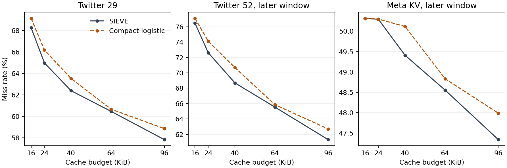

# CacheTriage

CacheTriage is a C++17 cache that tests when machine learning is worth
using for eviction. Learned policies start with SIEVE's choice and can
override it. The experiments measure backing-store reads, CPU time, and
cache memory across trace replay and a local SQLite demo.

## Benchmark summary

| Comparison | Lower miss or query count | Result on the three evaluated trace windows |
| --- | --- | --- |
| 128 entries per policy | Compact logistic | Fewer misses on all three windows. On Twitter 29, misses fell from 61,656 to 60,639. |
| 40 KiB per policy, placeholder values | SIEVE | Fewer misses on all three windows. The budget fit 538 SIEVE entries or 397 compact logistic entries. |
| 40 and 64 KiB per policy, 256-byte SQLite profiles | Compact logistic | Fewer queries in all six comparisons. The largest saving was 265 queries out of 62,180 (0.42%). |

The compact model tracks 16 bytes of history per entry. At 128 entries,
it matched every eviction made by the original 32-byte version across
the three windows. In the saved SQLite run, median request-loop CPU
was within 2% of SIEVE and median p95 matched at the reported precision.
[Benchmark details](#compare-compact-logistic-at-equal-memory) ·
[Raw results](benchmarks/compact-logistic-memory.json)

## Quick demo

Run these commands from the project root on macOS with Apple Clang, Make,
and SQLite development headers. The demo uses the bundled eight-request
trace and exported model, so it needs no downloads or training tools.

```sh
make demo
./build/cachetriage_demo 3 tests/always_score.txt \
  benchmarks/twitter-cluster052-reuse-v1.txt 1 4
```

The demo starts each policy with room for three profiles and replays eight
reads. On a hit it returns the cached profile. On a miss it runs a real
SQLite query and fills the cache. The last two arguments set the gate's
maximum age gap to one read and run four measured rounds.

The terminal prints JSON with the following counts, plus mean, p50, and p95
request latency. Timing varies from run to run.

| Policy | SQLite queries | Model calls |
| --- | ---: | ---: |
| LRU | 6 | 0 |
| SIEVE | 6 | 0 |
| Always-score | 5 | 2 |
| CacheTriage | 5 | 1 |

When key `5` arrives, SIEVE would evict `1`. The gate calls the model,
which evicts `4` instead. The last request for `1` then hits, avoiding a
SQLite query. This tiny trace shows the decision by hand. The real traces
below measure how often that tradeoff pays off.
[Follow the eviction and its model scores](#replay-the-learned-policy)

## Earlier experiments

- **Held-out traffic.** On 99,284 Twitter cluster 24 reads at 128 items,
  CacheTriage saved **140 misses** versus SIEVE and scored about **60% of
  evictions**. The miss advantage varied with cache size.
  [Held-out report](benchmarks/twitter-cluster024-holdout.json)
- **Backing-store cost.** Warm local SQLite favored SIEVE despite those
  140 saved queries. In a controlled follow-up, adding 80 µs per fetch
  gave CacheTriage an average-latency advantage of **about 0.17%**.
  SIEVE had the better median paired p95 at every tested delay.
  [SQLite report](benchmarks/twitter-cluster024-sqlite-demo.json) ·
  [Delay sweep](benchmarks/twitter-cluster024-fetch-delay-sweep.json)
- **Systems optimization.** In a later replay benchmark, reusing the
  evicted entry's list and hash nodes cut CacheTriage's CPU time by
  **52.6%** on Wikimedia at 128 items. Miss counts, model calls, and
  victim swaps matched before and after.
  [Wikimedia report](benchmarks/wikimedia-upload-2019-node-reuse.json)

## How it works

- **LRU** evicts the least recently used entry.
- **SIEVE** scans in insertion order, giving entries marked visited a second chance.
- **Always-score** scores SIEVE's candidate and up to three alternatives, then evicts the key with the lowest predicted reuse.
- **CacheTriage** calls the same scorer only when SIEVE's choice and the first alternative have matching hit counts and close last-access ages.

Python fits logistic regression using reads since last access and hits
since admission. C++ loads the exported weights and scores locally.
The replay tool measures policy behavior on recorded requests. The SQLite
demo measures a single-process request path with real queries. The
experiments compare policies at equal item capacity and at equal
accounted cache memory.

## Reproduce the experiments

- [Cache behavior](#policy-behavior) and [Twitter baselines](#twitter-trace-baselines)
- [Decision logging](#inspect-sieve-eviction-decisions), [offline oracle](#replay-the-offline-oracle), and [model training](#train-the-reuse-model)
- [Gate validation](#gate-the-model-calls), [held-out benchmark](#held-out-benchmark), and [SQLite measurements](#run-the-sqlite-backing-store-demo)
- [Pairwise replay](#replay-the-pairwise-policy-on-fresh-traffic) and [equal-memory comparison](#compare-compact-logistic-at-equal-memory)
- Additional workloads from [Meta](#test-the-scorer-on-meta-kv-traffic), [Wikimedia](#reuse-eviction-storage-on-wikimedia-traffic), and [Tencent](#replay-tencent-qqphoto-traffic)

Run `make test test-demo test-counterfactual test-pairwise` to check the
cache, replay outputs, SQLite query counts, and pairwise victim choices.
These tests use the bundled fixtures and Python 3's standard library.
The walkthroughs below include the setup for the larger benchmarks.

### Retest all six trace slices

Use the download commands below to populate the six trace prefixes in
`build/`. The Tencent converter requires `zstd`.

```sh
make test test-demo
PYTHONPATH=scripts python3 -B -m unittest discover -s tests
python3 -B scripts/retest_all.py > build/pre-github-retest.json
```

The runner prepares the inputs again, checks their digests, and replays
the four policies at 128, 512, 2,048, and 8,192 items. It compares counts
with saved results where they overlap and checks SQLite query and model
call counts at 128 items. The model and one-read gate stay fixed. Timing
varies across runs. [Saved clean-build retest](benchmarks/pre-github-retest.json)


## Run the LRU and SIEVE baseline

With Apple Clang and Make available, run these commands from the project root.

```sh
make
./build/cachetriage 3 traces/example.txt
make test
```

The CLI streams each read to two independently initialized, empty caches and
prints one JSON report. It includes the capacity in items, request count, and
each policy's hits, misses, evictions, and miss rate. The miss rate is
`misses / requests`, or `null` for an empty trace. Invalid input produces a
diagnostic on standard error and a nonzero exit status.

## Trace and capacity

- Each nonblank line is one read of an unsigned 64-bit decimal key in request
  order. Surrounding whitespace and blank lines are allowed. The file can end
  with or without a newline.
- Each read miss immediately admits the key if capacity is positive. A full
  cache evicts one resident to make room. At capacity zero every read misses
  and the cache admits and evicts zero entries.
- The replay simulates key residency with placeholder values. The budget is
  the maximum number of resident entries. Payload size and policy bookkeeping
  are outside this budget, so the sample makes an item-capacity comparison.
- The input represents reads only. Writes, deletes, and expiration have no
  replay semantics in this format.

## Policy behavior

The cache header at `include/cachetriage/cache.hpp` can be used independently of
the CLI. Choose a policy when constructing a cache. A lookup touches a resident
entry and returns a pointer to its value, valid until eviction or cache
destruction. Inserting a resident key replaces and touches it. Inserting a new
key returns the evicted key when one was needed.

LRU moves a hit to the most recent end of the list and evicts the least
recently used entry. SIEVE preserves insertion order and sets a visited bit on
hits. Its persistent hand scans from older to newer entries, clearing visited
bits until it finds an unvisited victim. The hand saves the victim's successor,
or wraps to the oldest resident when it next needs a candidate. New entries
start unvisited. [SIEVE paper, Algorithm 1](https://www.usenix.org/conference/nsdi24/presentation/zhang-yazhuo)

At capacity 3, the sample trace `1 2 3 3 1 4 5 3` gives these results.

| Policy | Hits | Misses | Victims in order | Miss rate |
| --- | ---: | ---: | --- | ---: |
| LRU | 2 | 6 | 2, 3, 1 | 75% |
| SIEVE | 3 | 5 | 2, 4 | 62.5% |

Both policies evict key 2 to admit 4. When 5 arrives, LRU evicts 3 because it
was accessed least recently. SIEVE resumes at 3, clears its visited bit, and
evicts the unvisited 4. The last read of 3 therefore hits only under SIEVE.
The unit checks verify each victim and exercise a full SIEVE scan where every
entry starts visited. The replay check compares the CLI output with the
expected JSON. The sample establishes correctness on a hand-checkable trace.

## Twitter trace baselines

These pilots use rows 1 through 100,000 from each of Twitter's March 2020
cluster 17 and cluster 52 production samples. The commands below pin the
source to a Git revision and fetch the first 8 MiB, enough to cover the
selected rows. Twitter recommends both workloads for eviction experiments.
The source data is provided under CC BY 4.0. [Twitter trace documentation](https://github.com/twitter/cache-trace)

```sh
make
cluster=017  # Use 052 for the other sample.
curl -fLsS --max-time 60 --range 0-8388607 --max-filesize 8388608 \
  -o "build/cluster${cluster}.csv" \
  "https://raw.githubusercontent.com/twitter/cache-trace/1c503676d6972d4394a360e09162149a6c00f516/samples/2020Mar/cluster${cluster}" &&
python3 scripts/twitter_baseline.py "build/cluster${cluster}.csv" > "build/twitter-cluster${cluster}.json" &&
diff -u "benchmarks/twitter-cluster${cluster}.json" "build/twitter-cluster${cluster}.json"
```

The Python 3 runner selects the contiguous window before filtering. It keeps
`get` and `gets` and ignores all other operations, so writes, deletes, and TTLs
do not affect simulated residency. Both read operations count as requests
regardless of the recorded value size. The runner orders reads by timestamp,
using source order within the same second, and assigns a unique numeric ID to
each distinct read key. Each replay begins with an empty cache.

| Sample | Reads | Distinct read keys | Recorded seconds | Source timestamp descents |
| --- | ---: | ---: | --- | ---: |
| [Cluster 17](benchmarks/twitter-cluster017.json) | 99,668 | 24,468 | 0–138 | 0 |
| [Cluster 52](benchmarks/twitter-cluster052.json) | 92,236 | 37,538 | 0–6 | 11 |

The JSON reports include a SHA-256 digest of each selected set of raw rows,
operation counts, and both policies' results at 128, 512, 2,048, and 8,192
items. SIEVE had fewer misses at all four capacities on the cluster 17 slice.
On the cluster 52 slice, LRU had fewer misses at 2,048 items and SIEVE had
fewer at the other three capacities.

Use `--start-row`, `--rows`, or `--capacities` to change the experiment.
These runs measure cold-start misses on two read-only slices at equal item
counts. Each slice covers a different amount of elapsed time.

## Inspect SIEVE eviction decisions

Run `./build/cachetriage 3 traces/example.txt --sieve-decisions` to see the
shortlist for each SIEVE eviction. Each CSV row starts with the one-based
request number and the victim key, followed by up to three alternatives.
The alternatives are the next residents after the victim in insertion order,
wrapping to the oldest entry if needed. The incoming key is outside the
shortlist. For example, `7,4,1,3` means request 7 evicted key 4 and had keys 1
and 3 as alternatives. Collecting the shortlist leaves SIEVE's decisions
unchanged.

Use the previously downloaded trace prefixes to count opportunities offline.

```sh
make
python3 scripts/twitter_baseline.py build/cluster017.csv --sieve-lookahead 100
python3 scripts/twitter_baseline.py build/cluster052.csv --sieve-lookahead 100
```

A decision counts when SIEVE's victim is requested again within the next
100 reads and at least one alternative goes unused in that same window.
Evictions without a complete lookahead window are excluded from the rate.
The reports retain the original replay results alongside these counts.
Lookahead is used only after replay to label the decisions. Changing a
victim could change future cache contents, so these counts measure local
opportunities along SIEVE's original run.

[Cluster 17 opportunity report](benchmarks/twitter-cluster017-sieve-opportunities.json) ·
[Cluster 52 opportunity report](benchmarks/twitter-cluster052-sieve-opportunities.json)

## Replay the offline oracle

The oracle runs a separate SIEVE cache on the same requests. On each
eviction, it checks whether SIEVE's chosen victim returns in the next
100 reads. If it does, the oracle picks the first shortlisted alternative
that stays unused in that window. If the window is incomplete or there is
no such alternative, the cache uses SIEVE's choice. The SIEVE scan clears
visited bits as usual, and the hand resumes after the entry actually removed.
Later evictions therefore use the cache state produced by earlier swaps.

```sh
make
python3 scripts/twitter_baseline.py build/cluster017.csv --capacities 128 --sieve-oracle 100
python3 scripts/twitter_baseline.py build/cluster052.csv --capacities 128 --sieve-oracle 100
```

At 128 items, the oracle saved 571 misses on cluster 17 and 4,311 on
cluster 52 versus ordinary SIEVE. The oracle uses future requests, which
are unavailable to a live cache. It tests one shortlist rule and one
lookahead, so these results describe that offline policy on the two slices.

`make test` includes a six-read example. At capacity three, the trace
`1 2 3 4 1 2` makes SIEVE evict key 1 when key 4 arrives. The two-read oracle
evicts key 3 instead and hits on both remaining requests.

[Cluster 17 oracle report](benchmarks/twitter-cluster017-sieve-oracle.json) ·
[Cluster 52 oracle report](benchmarks/twitter-cluster052-sieve-oracle.json)

## Measure one eviction override

The counterfactual replay takes snapshots of ordinary SIEVE immediately
before sampled evictions. Each snapshot preserves the resident order,
visited bits, and hand position. One branch evicts SIEVE's choice.
Each other branch evicts a different candidate from the same shortlist.
All branches then use ordinary SIEVE for the next 100 reads, starting
from the cache state their first choice produced.

```sh
make test test-counterfactual
./build/cachetriage_counterfactual 3 tests/oracle.txt 2 1
python3 -B scripts/evaluate_counterfactuals.py > build/sieve-counterfactual-development.json
```

On the tiny trace `1 2 3 4 1 2`, the three candidates for eviction at
request 4 are keys 1, 2, and 3. Evicting them causes two, one, and zero
misses, respectively, over the next two reads. The triggering miss is
common to all branches and excluded from these counts.

The development run samples one eviction from each equal-count bin of
eligible decisions, up to 1,000 per slice at 128 items. It excludes
evictions without a complete lookahead window and checks each sampled
shortlist against the ordinary replay CLI. The label is SIEVE's future
misses minus the alternative's future misses. Positive means the
override helped, zero is a tie, and negative means it hurt. A single
decision can have both helpful and harmful alternatives.

Add `--labels-out` with a new filename under `build/` to export JSONL.
Each row includes candidate ages, resident hits, reads since admission,
and the gap between the last two accesses when available. Those features
are taken before eviction. Future misses are offline labels. The branch
effects are local to the sampled SIEVE state, so adding them up would
give no measured miss reduction for a continuously learned policy.

Of 4,000 sampled decisions, 287 had a beneficial alternative. The
Twitter cluster 52 validation slice accounted for 252 of them. Meta
had 21, Wikimedia had 14, and Tencent had zero in the sample. The
experiment reuses the existing shortlist and leaves training for the
next stage. [Development report](benchmarks/sieve-counterfactual-development.json)

The broader idea of using future requests to teach a cache policy also
appears in [Learning Relaxed Belady](https://www.usenix.org/conference/nsdi20/presentation/song).


## Train the reuse model

Export a few examples from the tiny trace and verify them by hand.

```sh
make
python3 -B scripts/sieve_examples.py traces/example.txt --capacity 3 --horizon 2
PYTHONPATH=scripts python3 -B -m unittest discover -s tests -p 'test_sieve_examples.py'
```

Each row describes one resident on SIEVE's shortlist before the eviction.
`age_reads` is the current request number minus the key's last access
number, counting its admission as an access. `resident_hits` counts hits
since admission and resets when a key is admitted again. `reused` is 1 if
the key returns within the next `--horizon` reads. The exporter reads SIEVE's
decision log to reconstruct resident state from past requests. It uses
future requests only for labels and skips incomplete lookahead windows.
Request number, key ID, and shortlist rank identify rows for inspection.

To train, use a Python environment with NumPy and scikit-learn. The saved
run used scikit-learn 1.6.1.

```sh
python3 -B scripts/train_sieve.py build/cluster052.csv \
  --model-out build/twitter-cluster052-reuse-v1.txt \
  > build/twitter-cluster052-reuse-validation.json
```

The trainer uses 128 items and a 100-read horizon by default. It fits on
the first 70% of the ordered reads and validates on the last 30%. Each
split starts with an empty cache and supplies its own label lookahead.
Only `log1p(age_reads)` and `log1p(resident_hits)` go into logistic regression.
The exported text file contains a format identifier, an intercept, and a
weight for each transformed feature. Add the intercept and weighted
features to score reuse. Higher scores mean higher predicted reuse, and
the sigmoid converts a score to a probability.

The saved validation run reached 0.605 ROC AUC and 0.145 average precision,
with 7.53% of candidate rows labeled reused. These metrics evaluate
predictions on logged SIEVE candidates. Full policy replay and final
evaluation on a separate workload are later milestones.

[Exported model](benchmarks/twitter-cluster052-reuse-v1.txt) ·
[Validation report](benchmarks/twitter-cluster052-reuse-validation.json)

## Fit a model to eviction outcomes

The pairwise trainer compares each alternative with SIEVE's victim.
Its label is positive when the counterfactual branch saves at least one
miss over the next 100 reads. Ties and harmful alternatives stay in the
training set as non-positive examples. The model sees the victim's
features and the differences between the alternative and victim.

```sh
make all counterfactual
python3 -B scripts/train_pairwise.py build/cluster052.csv \
  --model-out build/twitter-cluster052-pairwise-v1.json \
  > build/twitter-cluster052-pairwise-offline.json
```

Use a Python environment with NumPy and scikit-learn. The saved run used
NumPy 2.1.3 and scikit-learn 1.6.1. The first 60% of the ordered cluster 52
reads supply training examples. The next 20% are used to select the model
and score threshold, and the last 20% are used for offline evaluation.
Each split starts with an empty cache and supplies its own lookahead.

The basic logistic model uses age and hits. The history logistic and
boosted trees also use reads since admission and the gap between the
last two accesses. The boosted model has 80 trees of depth at most two.
All features are available at eviction time. The trainer checks that
scores from the exported JSON match scikit-learn.

Calibration selected the boosted model at a probability threshold of
0.45. On 2,000 later sampled evictions it chose 308 overrides, of which
270 helped, 21 tied, and 17 hurt. The net sum of branch gains was 1,226,
versus 1,105 for basic logistic regression. Adding history to logistic
regression gave 1,097. These sums describe independent choices starting
from recorded SIEVE states. Lookahead windows can overlap, and a live
override changes later cache contents. The next section follows those
effects in a continuous replay.

[Exported pairwise models](benchmarks/twitter-cluster052-pairwise-v1.json) ·
[Offline evaluation](benchmarks/twitter-cluster052-pairwise-offline.json)


## Replay the pairwise policy on fresh traffic

The C++ pairwise runner scores alternatives from the cache's current
state. An override changes the resident set and SIEVE hand for later
requests. The logistic cutoff stays at 0.30 and the boosted cutoff at
0.45, as selected on the earlier calibration window. Both are compared
with SIEVE, the eight-hit gate, and a simple history rule. The rule
keeps a victim still within its last reuse interval when it can evict
an older candidate with fewer hits.

```sh
make all pairwise test-pairwise
curl -fLsS --max-time 60 --range 0-8388607 --max-filesize 8388608 \
  -o build/cluster029.csv \
  https://raw.githubusercontent.com/twitter/cache-trace/1c503676d6972d4394a360e09162149a6c00f516/samples/2020Mar/cluster029
python3 -B scripts/run_pairwise_replay.py > build/pairwise-fresh-replay.json
```

The script also uses the existing cluster 52 and Meta prefixes, taking
source rows 100,001–140,000 and 200,001–300,000 respectively. Cluster 29
was unused in training and tuning. All three windows start with an
empty cache. The runner converts the saved model to a compact text
format for C++. Replay uses the exported model and Python standard library.

In the original run with full-history logistic, at 128 items both
pairwise policies had fewer misses than SIEVE on all three windows. On cluster 29, logistic saved 1,017 misses and the trees
saved 975. Logistic used 4.72 ms of replay CPU versus SIEVE's 3.41 ms.
The boosted model used 44.78 ms. The simpler model also had fewer misses
than the trees on the later cluster 52 window.

At a shared **40 KiB accounted budget**, SIEVE had the fewest misses on
all three windows. For example, the budget held 538 SIEVE entries,
370 pairwise logistic entries, or 230 boosted entries. The accounting
includes inline replay state, peak cache heap allocations, resident
features, and the applicable model and lookup table. Requests, allocator
bookkeeping, stack scratch space, and real payloads are outside this
placeholder-value replay. The benchmark measures replay CPU and
throughput. Backing-store latency is a separate measurement.

[Original full-history benchmark](benchmarks/pairwise-fresh-replay.json)

The replay command now uses the compact logistic implementation. Its
equal-item decisions match the original. Its memory use and equal-byte
results are reported below.


## Compare compact logistic at equal memory

Basic pairwise logistic needs last access and hits since admission.
Its per-entry history is now 16 bytes on the test Mac, down from 32.
The scorer also computes the SIEVE victim's feature terms once per
shortlist. The model weights and cutoff stay frozen. At 128 items a
side-by-side replay checked every hit and all 161,998 victim keys across
the same three windows. They matched throughout.

The placeholder-value replay sweeps 16, 24, 40, 64, and 96 KiB. At
40 KiB the compact model fits 397 entries, up from 370. SIEVE fits 538
and still has fewer misses on each window. Scanning capacities in order
gives the first compact capacity that meets or beats SIEVE's miss count.

| Window | SIEVE misses at 40 KiB | Compact misses at 40 KiB | First matching compact capacity | Accounted KiB at match |
| --- | ---: | ---: | ---: | ---: |
| Twitter 29 | 53,380 | 54,356 | 493 | 46.9 |
| Twitter 52, later | 25,467 | 26,209 | 484 | 46.2 |
| Meta KV, later | 71,243 | 72,262 | 535 | 50.2 |

The scan tests each capacity in order because a larger cache can change
the eviction sequence. Hash-table growth can also jump over a byte
budget. At those first matching capacities, saving a further 8 bytes per
record alone would still leave each case over 40 KiB.



With 256-byte profiles in SQLite, the same 40 KiB fits 122 SIEVE
profiles or 110 compact logistic profiles. At 64 KiB those capacities
are 197 and 183. Compact logistic made fewer queries in all six runs.

| Window | SQLite reads saved at 40 KiB | SQLite reads saved at 64 KiB |
| --- | ---: | ---: |
| Twitter 29 | 265 | 240 |
| Twitter 52, later | 59 | 83 |
| Meta KV, later | 6 | 12 |

In the saved run, median request-loop CPU was within 2% of SIEVE in
all six comparisons, and both policies had the same median p95 at
the reported precision. Each of the 16 measured rounds starts with an
empty application cache and uses the same local SQLite connection.
Cache accounting includes the actual profile payloads, requested cache
heap, inline cache state, and the relevant model and log table.
SQLite's internal cache, the trace, and benchmark buffers are separate.
A database read here means one SQLite query. These are generated profiles
and a warm local database.

Use the same raw trace prefixes as the [pairwise replay](#replay-the-pairwise-policy-on-fresh-traffic).
Matplotlib is needed only for the optional plot.

```sh
make test-pairwise
python3 -B scripts/run_compact_logistic.py > build/compact-logistic-memory.json
# Add --plot build/compact-logistic-memory.png to regenerate the plot.
```

[Compact logistic benchmark report](benchmarks/compact-logistic-memory.json)


## Replay the learned policy

Always-score loads the exported model once. Each resident tracks its last
access and hits since admission. When the cache needs to evict, it scores
the same shortlist as the oracle using only those two features. It evicts
the candidate with the lowest reuse score, keeping the earliest candidate
in shortlist order on a tie. The sigmoid preserves score order, so the
policy can compare scores directly. A model call means one scoring pass
over the shortlist, including when the pass keeps SIEVE's choice.

Run the hand-checkable trace with the saved model.

```sh
make test
./build/cachetriage 3 tests/always_score.txt --always-score benchmarks/twitter-cluster052-reuse-v1.txt
```

At request 7 of `1 2 3 1 2 4 5 1`, the incoming key is 5 and SIEVE's
shortlist is 1, 2, 4. SIEVE picks 1. These are the model's reuse scores.

| Candidate | Reads since last access | Hits since admission | Reuse score |
| --- | ---: | ---: | ---: |
| 1 | 3 | 1 | -1.824 |
| 2 | 2 | 1 | -1.738 |
| 4 | 1 | 0 | -1.994 |

The model evicts 4. The last request for 1 then hits under always-score
and misses under SIEVE.

To replay the exact validation suffix used in training, use the same
source slice with `--validation-only`. Every policy starts empty.

```sh
python3 -B scripts/twitter_baseline.py build/cluster052.csv \
  --capacities 128 --validation-only \
  --always-score benchmarks/twitter-cluster052-reuse-v1.txt
```

On those 27,671 reads, SIEVE had 22,731 misses and always-score had
23,001. Always-score called the model 22,873 times and chose a different
victim from the SIEVE candidate on 228 calls. That count compares choices
inside the learned cache at decision time. The miss totals compare two
complete replays whose contents can diverge after a swap.

[Always-score validation report](benchmarks/twitter-cluster052-always-score-validation.json)

## Gate the model calls

CacheTriage compares SIEVE's victim with the first alternative in the
same shortlist. It calls the model when both entries have the same hit
count since admission and their last-access ages differ by at most the
configured number of reads. It then scores the entire shortlist exactly
as always-score does. At gap zero it always keeps SIEVE's choice.

```sh
make test
./build/cachetriage 3 tests/always_score.txt --triage benchmarks/twitter-cluster052-reuse-v1.txt 1
python3 -B scripts/twitter_baseline.py build/cluster052.csv \
  --capacities 128 --validation-only \
  --gate-sweep benchmarks/twitter-cluster052-reuse-v1.txt
```

On the small trace, request 6 compares key 3 with key 1. Their hit counts
are 0 and 1, so the gate skips scoring. At request 7, keys 1 and 2 each
have one hit and their ages differ by one read. The gate calls the model,
which chooses key 4 from the full shortlist. The gated replay gets the
same five misses as always-score with one call instead of two.

On the validation suffix, SIEVE had 22,731 misses. The best positive gap
was one read, with 22,733 misses and 17,638 model calls across 22,605
evictions (78.03%). Always-score had 23,001 misses and 22,873 calls.
Every positive gap had more misses than ordinary SIEVE on this slice.
The first positive gap already passed most evictions because the first
two candidates often had zero hits and consecutive last-access positions.
Model call counts describe how often scoring ran. CPU time and memory
measurements are separate experiments.

Use `--gate-gaps` to choose different age thresholds. The sweep keeps
SIEVE and always-score as the zero-call and every-eviction references.
[Gate validation report](benchmarks/twitter-cluster052-gate-validation.json)

## Test a more selective hit gate

The hit gate calls the model only when SIEVE's victim has at least the
configured number of hits since admission and the first alternative has
zero. The model and shortlist stay fixed. The original one-read age gate
remains the default used by the quick demo.

```sh
make test test-demo
python3 -B scripts/tune_hit_gate.py > build/hit-gate-tuning.json
```

The script sweeps thresholds of 1, 2, 4, 8, 16, 32, and 64 at 128 items
on four development slices. It selects the lowest mean miss rate across
slices and breaks ties by model-call share. It then freezes the threshold
before opening later, nonoverlapping row windows from Twitter cluster 24
and Meta KV. SQLite runs three batches of 16 rounds per fresh window.

The selected threshold was eight hits. On the fresh Twitter window it
made zero calls and tied SIEVE's 26,084 misses. On the fresh Meta window
it made nine calls and reduced misses from 72,530 to 72,526. All three
Meta SQLite batches showed a slightly lower mean with the hit gate, with
a median paired advantage of about 0.001 µs per request. Replay CPU time
was still higher than SIEVE's on both windows. This result shows that the
gate can be very selective, with a small measured benefit on one window.

For a single numeric trace, use
`--triage-hits <model> <min-victim-hits>` or
`--benchmark-hits <model> <min-victim-hits> <rounds>` in the replay CLI.
For the SQLite demo, pass the minimum hit count in the threshold position
and append `--hit-gate`.
[Development and fresh-window results](benchmarks/hit-gate-tuning.json)


## Held-out benchmark

Cluster 24 is a separate workload from the cluster 52 training and
validation data and the cluster 17 development trace. The benchmark uses
the saved model and the one-read gate picked on validation. Both settings
stay fixed at all four capacities. It uses the first 100,000 source rows,
of which 99,284 are reads, from the same pinned dataset revision.
[Twitter trace documentation](https://github.com/twitter/cache-trace)

```sh
make test
PYTHONPATH=scripts python3 -B -m unittest discover -s tests
curl -fLsS --max-time 60 --range 0-8388607 --max-filesize 8388608 \
  -o build/cluster024.csv \
  https://raw.githubusercontent.com/twitter/cache-trace/1c503676d6972d4394a360e09162149a6c00f516/samples/2020Mar/cluster024
python3 -B scripts/twitter_baseline.py build/cluster024.csv \
  --capacities 128 512 2048 8192 --benchmark-rounds 16 --benchmark-gate-gap 1 \
  --benchmark benchmarks/twitter-cluster052-reuse-v1.txt \
  > build/twitter-cluster024-holdout.json
```

The C++ runner loads the trace and weights once, warms up each policy,
and rotates policy order over 16 measured rounds. Every round starts
with a fresh, empty cache. CPU time measures the process during replay.
Throughput divides request count by median elapsed replay time. The timed
section includes lookups, inserts, evictions, model calls, and allocations
during requests. Trace parsing, cache construction and destruction,
reporting, and the separate memory pass are outside that section.
The saved run used an Apple M5, macOS 26.6, and Apple Clang 21 with `-O2`.

A separate pass counts peak bytes requested by the cache's list and hash
table allocators, including the index buckets and transient allocations
during insertion. The report adds the inline replay object, including
the model and counters, to that peak. Learned policies store 16 bytes
of features per resident on this build. This is an item-capacity
comparison with placeholder payloads. The reported bytes cover policy
storage and exclude allocator bookkeeping, the preloaded trace, and
temporary stack storage. Timing samples vary across runs.

At 128 items, the gate avoided 140 misses versus SIEVE while calling the
model on about 60% of evictions. SIEVE still used less CPU and less
accounted memory. Across the other capacities the gate had 42 more
misses at 512, 18 fewer at 2,048, and the same misses at 8,192.
The report includes each policy's request counts and raw timing samples.

[Held-out benchmark report](benchmarks/twitter-cluster024-holdout.json)

## Run the SQLite backing-store demo

The demo uses the same C++ cache and learned victim selector as the replay.
It seeds a private temporary SQLite database with one generated 256-byte
profile per distinct trace key. For each read, the service checks the cache
first. A hit returns the stored profile. A miss executes a prepared SQLite
query and fills the cache with the returned profile. The demo counts
successful queries and checks the returned key on every request.

```sh
make test-demo
./build/cachetriage_demo 3 tests/always_score.txt benchmarks/twitter-cluster052-reuse-v1.txt 1 4
```

On the tiny trace, LRU and SIEVE each query SQLite six times. Always-score
and CacheTriage each query it five times, with two and one model calls
respectively. The last two arguments set the gate gap and the measured
round count.

Run the same request path on the held-out cluster 24 slice at 128 items.

```sh
make demo
python3 -B scripts/twitter_baseline.py build/cluster024.csv \
  --capacities 128 --backend-demo benchmarks/twitter-cluster052-reuse-v1.txt
```

The runner uses the one-read gate and eight measured rounds. It warms up
SQLite, rotates the order of the four policies, and starts each application
cache empty for every round. It reports the median across rounds of the
per-round mean, p50, and p95 request latency. p95 is the time at or below
which 95% of requests completed in a round. The timer starts at cache lookup
and stops when the profile is available and any fill is complete. The
measurement covers this single-process SQLite request path. Database setup,
file parsing, network transport, and concurrent traffic are outside it.

CacheTriage made 64,512 SQLite reads versus 64,652 for SIEVE. The saved
local run showed a higher mean and p95 for CacheTriage despite the smaller
query count. This workload and warm backing store represent one point in
the tradeoff between model cost and avoided query cost.

[SQLite demo report](benchmarks/twitter-cluster024-sqlite-demo.json)

## Vary the cost of a backend fetch

The delay sweep keeps cluster 24, 128 items, the saved model, and the
one-read gate fixed. It compares SIEVE and CacheTriage at 0, 10, 20, 40,
and 80 microseconds of added delay per successful SQLite fetch.

```sh
make test-demo
python3 -B scripts/twitter_baseline.py build/cluster024.csv \
  --capacities 128 --backend-demo benchmarks/twitter-cluster052-reuse-v1.txt \
  --demo-rounds 4 --demo-delays 0 10 20 40 80 \
  > build/twitter-cluster024-fetch-delay-sweep.json
```

The demo busy-waits after each successful SQL fetch and before filling
the cache. Hits skip this delay. It measures the actual wait so scheduler
overshoot is visible. This is a controlled serial latency experiment.
The busy wait consumes CPU, and network latency and concurrent requests
are outside the measurement.

Each setting gets four paired rounds with fresh caches. The runner rotates
delay settings and alternates which policy goes first. Each paired delta
subtracts SIEVE's latency from CacheTriage's in the same round. Negative
deltas favor CacheTriage. The report includes the individual deltas and
their median for both mean and p95 latency.

CacheTriage saved 140 queries at every setting. At zero delay, SIEVE had
lower mean latency in all four pairs. At 80 microseconds, CacheTriage had
lower mean latency in all four pairs by a median 0.090 microseconds per
request. The intermediate settings were mixed, and the median paired p95
favored SIEVE at all five settings. A fixed-cost estimate using the
zero-delay mean gap and the 140 avoided queries puts the crossover near
13 microseconds of added cost per fetch. The measured pairs show why that
estimate is approximate.

[Fetch-delay sweep report](benchmarks/twitter-cluster024-fetch-delay-sweep.json)

## Test the scorer on Meta KV traffic

Meta's June 2022 key-value trace provides a second source of real cache
requests. The converter takes the first 100,000 data rows in file order
and expands each GET by its `op_count`. It assigns IDs to distinct keys
and skips SET and DELETE. The selected slice produces 229,690 reads of
45,031 distinct keys. The trace format supplies file order for this run.
This replay uses an item limit and admits on read misses.
[Meta CacheLib trace documentation](https://cachelib.org/docs/Cache_Library_User_Guides/Cachebench_FB_HW_eval/)

```sh
make test test-demo
curl -fLsS --max-time 60 --range 0-8388607 --max-filesize 8388608 \
  -o build/meta-kv-202206-prefix.csv \
  https://cachelib-workload-sharing.s3.amazonaws.com/pub/kvcache/202206/kvcache_traces_1.csv
python3 -B scripts/prepare_meta_kv.py build/meta-kv-202206-prefix.csv build/meta-kv-202206-reads.txt
./build/cachetriage 128 build/meta-kv-202206-reads.txt \
  --benchmark benchmarks/twitter-cluster052-reuse-v1.txt 1 16
```

The scorer now looks up `log1p` for integer feature values 0 through 255
in a shared table and evaluates larger inputs directly. The before/after
comparison uses the same trained weights, gate, and shortlist. It
alternates binary order across four pairs, with 16 measured rounds per
binary invocation. At 128 items on Meta, the median paired CPU reduction
was 17.0% for always-score and 8.2% for CacheTriage. Misses, calls, and
swaps matched exactly. The benchmark now counts the 2 KiB shared table
in the learned policies' memory totals.

On this Meta slice at 128 items, SIEVE had 72,936 misses, CacheTriage had
72,927, and always-score had 72,073. SIEVE still had the lowest measured
CPU time among the three. The model and gate were carried over from the
Twitter validation run.

[Meta and Twitter before/after report](benchmarks/meta-kv-202206-score-optimization.json)

## Reuse eviction storage on Wikimedia traffic

This replay uses the first 200,000 requests from the 2019 Wikimedia
upload-cache sample. The converter skips the file preamble, assigns
numeric IDs to anonymized object keys, and sorts by timestamp while
keeping source order within a second. The slice has 152,251 distinct
keys across recorded seconds 0 through 114. It is an item-capacity
replay of object reads.
[Wikimedia trace format](https://wikitech.wikimedia.org/wiki/Data_Platform/Data_Lake/Traffic/Caching)
[Public trace mirror](https://github.com/cacheMon/cache_dataset#Wikimedia-CDN-Request-Traces)

```sh
make test test-demo
curl -fLsS --max-time 60 --range 0-8388607 --max-filesize 8388608 \
  -o build/wiki-upload-2019-prefix.txt \
  https://cache-datasets.s3.amazonaws.com/cache_dataset_txt/2019_wiki/wiki/2019/wiki.upload.2019.short
python3 -B scripts/prepare_wiki_upload.py build/wiki-upload-2019-prefix.txt build/wiki-upload-2019-reads.txt
./build/cachetriage 128 build/wiki-upload-2019-reads.txt \
  --benchmark benchmarks/twitter-cluster052-reuse-v1.txt 1 16
```

When the cache is full and the value supports nonthrowing move assignment,
it reuses the victim's hash-table node and list entry. It replaces the
key and value, resets the visited bit, and moves the entry to the end of
the list. SIEVE's hand resumes after the actual victim. Values with
potentially throwing move assignment use staged insertion, which preserves
the resident if staging fails.

At 128 items on Wikimedia, median paired CPU time fell 52.6% for
CacheTriage, 53.3% for always-score, and 59.7% for SIEVE. At 512 items,
CacheTriage fell 50.2%. Misses, model calls, and victim swaps matched
before and after. The comparison alternated binary order across four
pairs of invocations, with 16 measured rounds per invocation. We also
tested candidate pruning, a larger log table, and a zero-hit score
shortcut. Those experiments showed little or inconsistent benefit.

At 128 items, CacheTriage avoided 72 misses compared with SIEVE but
still scored about 96% of its evictions and used more CPU than SIEVE.
At 512 items, SIEVE and both learned policies had the same miss count.
This experiment holds the Twitter-trained weights and gate fixed.

[Wikimedia and Meta benchmark report](benchmarks/wikimedia-upload-2019-node-reuse.json)

## Replay Tencent QQPhoto traffic

This replay uses the first 200,000 rows of the public Tencent QQPhoto
trace. The converter expands a bounded compressed prefix, skips records
with an error format, and treats each photo ID, image format, and size
category combination as a separate object. It orders by timestamp and
preserves file order within a second. The selected rows give 200,000
reads and 179,617 distinct objects. The model and one-read gate are
carried over from the Twitter run.
[Tencent trace study](https://doi.org/10.1145/3205289.3205299)
[Trace format and mirror](https://github.com/cacheMon/cache_dataset#Tencent-Photo-CDN-Request-Traces)

```sh
make
curl -fLsS --max-time 60 --range 0-8388607 --max-filesize 8388608 \
  -o build/tencent-photo1-prefix.zst \
  https://cache-datasets.s3.amazonaws.com/cache_dataset_txt/2018_tencentPhoto/tencentPhoto1.sort.zst
python3 -B scripts/prepare_tencent_photo.py build/tencent-photo1-prefix.zst build/tencent-photo1-reads.txt
./build/cachetriage 128 build/tencent-photo1-reads.txt \
  --benchmark benchmarks/twitter-cluster052-reuse-v1.txt 1 16
```

The converter uses the `zstd` command and only reads enough decompressed
data to collect the requested rows. The benchmark compares policies at
equal item counts.

We also tested a candidate that avoids checking the index a second time
when a learned-policy lookup misses and the cache admits the fetched
entry. The candidate preserved misses, model calls, and swaps. At both
Tencent capacities it lowered CacheTriage's median paired CPU time by
about 2.3%, but LRU replay CPU rose in the same candidate builds. The
current implementation retains the previous insertion path. The report
keeps the candidate timings as an experiment.

At 128 items, SIEVE had 196,324 misses, CacheTriage had 196,315, and
always-score had 196,269. The gate still called the model on 98.1% of
evictions. At 512 items the three policies differed by at most five
misses.

[Tencent benchmark and candidate timings](benchmarks/tencent-photo1-access-optimization.json)
